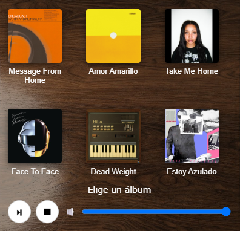
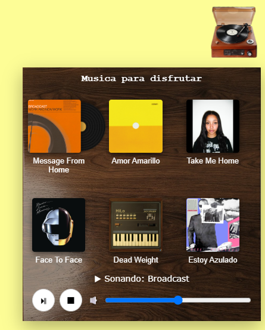
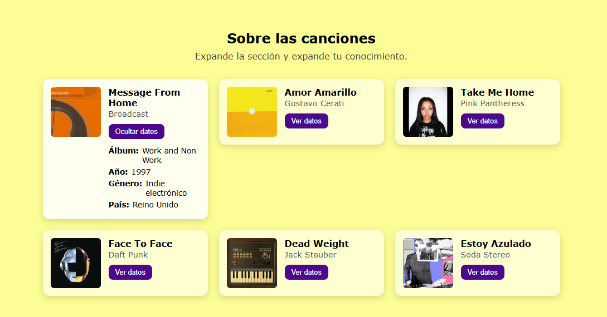

# Portada

- **Nombre:** Kevin Peralta Nava Peralta
- **Materia / grupo:** Programación Web / 7SC
- **Fecha:** 14/10/2026

# Caja de música en React

Mini aplicación hecha con **React + Vite** para la actividad *t3_act4_react*. Es una página con un mensaje animado, una sección con datos de cada canción y una **caja de música** flotante que reproduce discos con un vinilo animado.

---

## Captura general


---

## Tecnologías

- React 18
- Vite 5
- CSS

## Cómo ejecutarlo

```bash
npm install
npm run dev        # servidor local, normalmente http://localhost:5173
```

Para publicar en GitHub Pages:

```bash
npm run deploy     # hace el build y sube la carpeta dist a la rama gh-pages
```

> Las imágenes y la música van en `public/img/` y `public/music/`.

## Estructura del proyecto

```
t3_act4_react/
├─ index.html
├─ package.json
├─ vite.config.js            ← base: '/t3_act4_react/'
├─ public/
│  ├─ img/                   ← imágenes y portadas
│  └─ music/                 ← archivos .mp3
└─ src/
   ├─ main.jsx               ← conecta React con index.html
   ├─ App.jsx                ← arma la página con los componentes
   ├─ index.css              ← estilos globales
   ├─ data/
   │  └─ canciones.js        ← arreglo con las 6 canciones y sus datos
   └─ components/
      ├─ Encabezado.jsx          (a) componente simple
      ├─ Parrafo.jsx             (b) props
      ├─ Album.jsx               (b) props
      ├─ FichaCancion.jsx        (b) props
      ├─ CajaMusica.jsx          (c) estado + (d) lista
      ├─ BibliotecaCanciones.jsx (c) estado + (d) lista
```

---

## Puntos principales

### a) Un componente funcional simple

Un componente es una función que devuelve JSX. `Encabezado` no recibe datos ni cambia: solo muestra el título y la imagen de bienvenida.

**Archivo:** `src/components/Encabezado.jsx`

```jsx
function Encabezado() {
  return (
    <>
      <header className="header">
        <h1>Hola querida</h1>
      </header>
      
    </>
  )
}
export default Encabezado
```

Se usa en `App.jsx` como una etiqueta: `<Encabezado />`.


---

### b) Un componente que recibe y muestra props

`Album` recibe por props el título, la portada, si está sonando y qué hacer al hacer clic. El mismo componente se reutiliza para las 6 canciones.

**Archivo:** `src/components/Album.jsx`

```jsx
function Album({ titulo, portada, sonando, onElegir }) {
  return (
    <button className={`opcion ${sonando ? 'sonando' : ''}`} onClick={onElegir}>
      <div className="album">
        <div className="vinilo"></div>
        
      </div>
      <span className="nombre">{titulo}</span>
    </button>
  )
}
```

**Cómo se le pasan los datos** (en `CajaMusica.jsx`):

```jsx
<Album
  titulo={c.titulo}
  portada={c.portada}
  sonando={actual?.id === c.id}
  onElegir={() => elegir(c)}
/>
```

Otros ejemplos de props: `Parrafo` recibe su texto como `children` y `FichaCancion` recibe el objeto `cancion`.

<!-- Agrega aquí una captura de los álbumes dentro de la caja de música -->


---

### c) Un componente que usa estado (`useState`)

`CajaMusica` guarda en estado si la ventana está abierta, qué canción suena, si está en pausa y el volumen. Cuando el estado cambia, React vuelve a dibujar la pantalla solo.

**Archivo:** `src/components/CajaMusica.jsx`

```jsx
const [abierta, setAbierta] = useState(false)
const [actual, setActual] = useState(null)
const [pausado, setPausado] = useState(false)
const [volumen, setVolumen] = useState(0.5)
```

**Abrir y cerrar la ventana** (evento + clase según el estado):

```jsx
<button id="btn-menu" onClick={() => setAbierta(!abierta)}>...</button>
<div id="ventana" className={abierta ? 'abierta' : ''}>...</div>
```

**Renderizado condicional** del texto de estado:

```jsx
let estado = 'Elige un álbum'
if (actual) {
  estado = pausado ? '⏸ En pausa' : `▶ Sonando: ${actual.artista}`
}
```

También se usa estado en `FichaCancion` (mostrar/ocultar los datos de una canción):

```jsx
{abierta && (
  <dl className="ficha_datos">...</dl>
)}
```





---

### d) Una lista renderizada dinámicamente con `.map()`

Las canciones viven en un arreglo (`src/data/canciones.js`) y se dibujan recorriéndolo con `.map()`. Si se agrega una canción al arreglo, aparece sola en la página.

**Datos** (`src/data/canciones.js`):

```js
export const canciones = [
  {
    id: 1,
    titulo: 'Message From Home',
    artista: 'Broadcast',
    album: 'Work and Non Work',
    anio: 1997,
    genero: 'Indie electrónico',
    pais: 'Reino Unido',
    audio: `${base}music/Message_From_Home.mp3`,
    portada: `${base}img/albumBroadcast.jpg`,
  },
  // ...5 canciones más
]
```

**Dibujar la lista** (`CajaMusica.jsx`):

```jsx
{canciones.map((c) => (
  <Album key={c.id} titulo={c.titulo} portada={c.portada}
         sonando={actual?.id === c.id} onElegir={() => elegir(c)} />
))}
```

Lo mismo en `BibliotecaCanciones.jsx` (fichas con datos) y en `App.jsx` con los párrafos del mensaje (`introduccion.map(...)`).

<!-- Agrega aquí capturas de la rejilla de álbumes y de la sección "Sobre las canciones" -->


## Preguntas

### a) ¿Qué diferencia hay entre props y state en React?

Las **props** son datos que un componente **recibe desde afuera** (de su componente padre). El componente solo las lee, no las puede modificar. Sirven para configurar un componente y reutilizarlo con distintos datos; por ejemplo, `Album` recibe `titulo` y `portada` y por eso el mismo componente dibuja las 6 canciones.

El **state** (estado) son datos que un componente **guarda y administra por sí mismo**, y que **pueden cambiar** con el tiempo. Cuando el estado cambia, React vuelve a dibujar el componente. Por ejemplo, `CajaMusica` guarda si la ventana está abierta o qué canción suena.

En resumen: las props vienen de afuera y no se modifican; el estado vive adentro y cambia.

### b) ¿Por qué es importante usar una `key` al renderizar una lista?

Cuando se dibuja una lista con `.map()`, React necesita saber **cuál elemento es cuál** para poder actualizarla de forma eficiente. La `key` es un identificador único y estable de cada elemento (en este proyecto, el `id` de la canción).

Gracias a la `key`, si la lista cambia (se agrega, se quita o se reordena un elemento), React solo modifica lo necesario en lugar de reconstruir todo, y conserva el estado de cada elemento (por ejemplo, qué ficha estaba abierta). Sin `key`, React muestra una advertencia y puede mezclar elementos o comportarse mal. Por eso conviene usar un id único (como `key={c.id}`) y no el índice del arreglo si la lista puede cambiar.

### c) ¿Qué hace `useState` y dónde se usó en la mini aplicación?

`useState` es una función de React que permite que un componente **recuerde un valor entre renderizados**. Devuelve dos cosas: el valor actual y una función para cambiarlo. Al usar esa función, React actualiza el valor y vuelve a dibujar el componente con el dato nuevo. Se escribe así:

```jsx
const [valor, setValor] = useState(valorInicial)
```

**Ejemplo en esta aplicación** (`CajaMusica.jsx`):

```jsx
const [abierta, setAbierta] = useState(false)

<button onClick={() => setAbierta(!abierta)}>...</button>
<div id="ventana" className={abierta ? 'abierta' : ''}>...</div>
```

`abierta` empieza en `false` (ventana cerrada). Al pulsar el icono se ejecuta `setAbierta(!abierta)`, el valor cambia a `true` y React vuelve a dibujar la ventana con la clase `abierta`, por lo que aparece en pantalla. También se usa para saber qué canción está sonando (`actual`), si está en pausa (`pausado`) y el volumen (`volumen`).

- **Repositorio:** `https://github.com/kp720/t3_act4_react`
- **Página publicada:** `https://kp720.github.io/t3_act4_react/`

